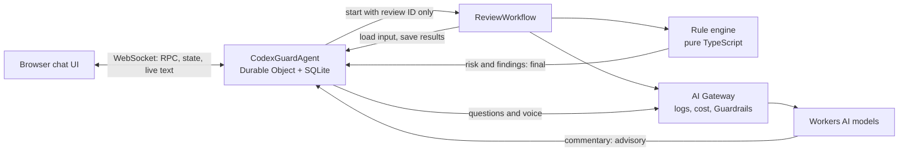

# Codex Guard

Codex Guard is a chat agent on Cloudflare that checks a proposed code or infrastructure change against a team's engineering standards before a pull request is opened.

Paste a unified diff, type a plain-language summary, or speak one. Fixed rules decide the risk level and which standards apply. A Workers AI model then explains the findings, cites the matching standard and suggests fixes. It cannot change the result. Every model call goes through Cloudflare AI Gateway for spend and prompt-injection monitoring.

All standards and sample changes in this repository are invented.

## What it does

1. **Takes untrusted input.** A change is size-capped, validated and parsed. Malformed diffs are rejected, because guessing could hide added lines from the rules.
2. **Runs deterministic rules.** Ten sample standards cover credentials, network ingress, permissions, migrations, CI gates, pinned inputs, tests, reviewer-directed text, debug output and change size.
3. **Streams progress and commentary.** Rule results appear first in their own panel. AI commentary streams into a separate panel labeled advisory.
4. **Remembers decisions.** A finding can be accepted as an exception with a reason. Later reviews of the same standard and file keep the finding visible and leave it out of the risk level.
5. **Answers follow-up questions** about the latest review, grounded in the stored rule result.
6. **Supports voice.** Speech is transcribed into the composer so you can check it before submitting. Reviews and answers can be read aloud, with the risk level always taken from the rule result.

Each repository name maps to its own agent, with its own standard settings, review history, exceptions and conversation.

## Architecture



| Path | Responsibility |
| --- | --- |
| `src/domain/input.ts` | Input limits, text normalization, unified diff parser |
| `src/domain/rules.ts` | Rule engine, risk calculation, secret redaction |
| `src/domain/standards.ts` | Invented sample standards |
| `src/domain/prompt.ts` | Prompt construction, offline text, checks on model output |
| `src/agent.ts` | Durable Object agent, SQLite memory, browser-callable methods |
| `src/workflow.ts` | Review steps: rules, commentary, save |
| `src/models.ts` | Primary and fallback model IDs |
| `src/gateway.ts` | AI Gateway options and request metadata |
| `src/llm.ts` | Streaming language-model calls and the offline mode |
| `src/speech.ts` | Speech-to-text and text-to-speech calls |
| `scripts/setup-gateway.mjs` | Creates or updates the gateway |
| `client/`, `public/` | Dependency-light chat and voice interface |

### Design decisions

- **The model has no path to the verdict.** `evaluateChange` is a pure function of the parsed change, standards and exceptions. Rule results are saved before the model is called, and model output is only ever stored as commentary.
- **A model failure does not lose the review.** Commentary is a retried Workflow step. If it still fails, the review completes with its rule results and says commentary is unavailable.
- **Raw input stays out of durable Workflow history.** The Workflow receives only a review ID. It reads the input from the agent, and step results hold redacted data. The agent deletes the raw input when the review ends.
- **Some standards are mandatory.** Credential and reviewer-instruction findings cannot be waived, and those standards cannot be turned off.

### Handling untrusted diffs

- Input over 40,000 characters or 4,000 lines is rejected, never truncated.
- Rules match after Unicode normalization with invisible characters removed.
- Text that addresses automated reviewers becomes a finding. It cannot lower the risk.
- Text sent to the model is redacted and wrapped in a per-review delimiter, and attempts to close that delimiter are removed.
- Model output is checked for unknown citations, skipped findings and contradictory risk claims. Problems are shown next to the commentary.
- The UI adds submitted and model text as text nodes, under a restrictive Content Security Policy.

### Models

| Purpose | Primary | Fallback |
| --- | --- | --- |
| Language model | `@cf/deepseek-ai/deepseek-v4.1-flash-1017` | `@cf/thinkingmachines/inkling-2-small` |
| Speech to text | `@cf/deepgram/nova-3` | `@cf/openai/whisper-large-v3-turbo` |
| Text to speech | `@cf/deepgram/aura-2-en` | `@cf/myshell-ai/melotts` |

The fallback runs only when the primary fails. A language-model fallback also requires that the primary produced no output yet.

Cloudflare lists `@cf/myshell-ai/melotts` for removal on 2026-11-20. After that date, text to speech has no working fallback until `src/models.ts` is updated.

The language models require the Workers Paid plan or prepaid AI Gateway credits.

### AI Gateway monitoring

- **Spend:** the gateway's Analytics page shows requests, tokens and estimated cost. Add a budget under **AI > AI Gateway > Settings > Spend limits**. Cost tracking is token-based, so check speech usage in the Workers AI dashboard as well.
- **Prompt injection:** Guardrails category `P1` is set to **Flag**. This app reviews hostile diffs on purpose, and blocking them would remove the commentary. Flagged requests appear in the gateway logs.
- **Rule comparison:** each request carries `rule_flagged_injection`, so logs show what the deterministic rule saw next to the Guardrails result.
- **Filtering:** requests also carry `app`, `repository`, `feature` and `review_id` metadata.

Guardrails does not enforce responses on streamed requests, and its documentation does not cover audio models. A spoken question is screened when its transcript reaches the language model. Enabling Guardrails adds Workers AI usage and some latency.

Gateway logs store prompts, which contain redacted excerpts of submitted changes. Transcription requests ask the gateway not to store the audio payload.

## Assignment requirements

| Requirement | How it is met |
| --- | --- |
| LLM | Workers AI through the `AI` binding and AI Gateway, in `src/llm.ts` |
| Workflow or coordination | Agents SDK Durable Object agent coordinating `ReviewWorkflow`, a Cloudflare Workflow |
| User input through chat or voice | Web chat UI with microphone input, served as Worker static assets and using the SDK's `AgentClient` |
| Memory or state | SQLite in each agent stores standards settings, reviews, exceptions and messages. Agent state syncs live progress |
| AI-assisted development record | [`PROMPTS.md`](./PROMPTS.md) |

## Local setup

Requires Node.js 22.18 or later.

```sh
npm install
npm run check
npm run dev
```

Open <http://127.0.0.1:8787>.

`npm run dev` uses `wrangler dev --local` with `AI_MODE=offline`. Everything runs on your machine, including the Durable Object and Workflow. Commentary comes from a template, voice input returns a labeled sample transcript, and Listen plays a test tone. No Cloudflare account is needed and no AI usage is billed.

To try the real models during local development, create the gateway below, sign in with `npx wrangler login`, and run:

```sh
npm run dev:ai
```

Workers AI always runs on Cloudflare, so this uses your account and can incur charges.

## AI Gateway setup

Preview the settings without changing anything:

```sh
npm run gateway:plan
```

Create an API token with **AI Gateway Read** and **AI Gateway Edit**, set `CLOUDFLARE_ACCOUNT_ID` and `CLOUDFLARE_API_TOKEN` in your shell, and run:

```sh
npm run gateway:apply
```

This creates or updates the `codex-guard` gateway with logs on, prompt injection flagged, and a limit of 120 requests a minute. It keeps settings already on the gateway. Do not commit the token.

## Testing

`npm run check` runs TypeScript checks and the test suite. Tests run in the Workers runtime through `@cloudflare/vitest-plugin` and cover:

- rule detection, file scoping, risk calculation and determinism
- exception memory across reviews, revocation, repository isolation and mandatory standards
- malformed, oversized, empty and non-text input
- prompt-injection text in added lines, context lines, preambles and zero-width disguises
- secret redaction, prompt construction and model-output checks
- complete reviews through the real agent and Workflow, using offline commentary
- gateway routing and primary-to-fallback behavior for all three model types, using a fake `AI` binding
- voice input validation, spoken text, per-repository AI limits and gateway settings

## Deployment

Create the gateway first, then run:

```sh
npx wrangler login
npm run deploy
```

Deployment creates the Worker, Durable Object class and Workflow, and uses Workers AI in the deployed account.

This is a demonstration with no user accounts. Anyone with the URL can open any repository name and read or change its memory. Each repository is limited to 30 reviews and 60 other AI actions an hour, but that does not cap total usage across names. Use a gateway spend limit as the account-level control. Before a shared deployment, put it behind [Cloudflare Access](https://developers.cloudflare.com/cloudflare-one/policies/access/) and add an account-level rate limit.

## Limitations

- Rules use patterns. They can miss a violation or flag a harmless line, so they support human review and do not replace it.
- A plain-language summary is checked by its wording only, and the UI says so.
- Exceptions match an exact standard and file path. They do not expire on their own.
