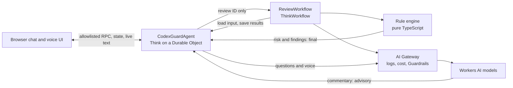

# Codex Guard

Codex Guard is a durable chat and voice agent on Cloudflare that checks a proposed code or infrastructure change against a team's engineering standards before a pull request is opened.

Paste a unified diff, type a plain-language summary, or speak one. Fixed rules decide the risk level and which standards apply. A Workers AI model then explains the findings, cites the matching standard and suggests fixes. It cannot change the result. Every model call goes through Cloudflare AI Gateway for spend and prompt-injection monitoring.

All standards and sample changes in this repository are invented.

## What it does

1. **Takes untrusted input.** Zod schemas validate every browser request. Changes are size-capped and parsed strictly, and malformed diffs are rejected.
2. **Runs deterministic rules.** Ten sample standards cover credentials, network ingress, permissions, migrations, CI gates, pinned inputs, tests, reviewer-directed text, debug output and change size.
3. **Streams progress and commentary.** Rule results appear in their own panel. AI commentary streams into a separate panel labeled advisory.
4. **Remembers decisions.** A finding can be accepted as an exception with a reason. Later reviews of the same standard and file keep it visible and leave it out of the risk level.
5. **Answers follow-up questions durably.** A question enters Think's inbox and finishes even if the browser closes.
6. **Supports voice.** Speech is transcribed into the composer for checking before submission. Reviews and answers can be read aloud, with the risk level always taken from the rule result.

Each repository name maps to its own Durable Object, with its own standard settings, reviews, exceptions and conversation.

## Architecture



| Path | Responsibility |
| --- | --- |
| `src/agent.ts` | Think agent, SQLite memory, browser methods, durable turns |
| `src/workflow.ts` | Durable review steps: rules, commentary, save |
| `src/access.ts` | Cloudflare Access token verification |
| `src/index.ts` | Worker routing and connection policy |
| `src/domain/schemas.ts` | Zod schemas and the browser RPC allowlist |
| `src/domain/input.ts` | Text normalization and the unified diff parser |
| `src/domain/rules.ts` | Rule engine, risk calculation and secret redaction |
| `src/domain/prompt.ts` | Prompt construction, offline text and model-output checks |
| `src/domain/audio.ts` | WAV validation and spoken text |
| `src/domain/gateway-config.ts` | AI Gateway setup logic |
| `src/llm.ts`, `src/speech.ts` | Model calls and fallbacks through AI Gateway |
| `client/`, `public/` | Chat and voice interface |

Source files carry documentation comments that explain each module's responsibility and its security and durability decisions.

### Durability with Think

This agent applies the pattern from [always-on-agent-cloudflare](https://github.com/bartrumb/always-on-agent-cloudflare):

| Need | Implementation |
| --- | --- |
| Durable inbox | Questions use Think's `submitMessages` with an idempotency key, so retries do not start another paid turn |
| Recovery | Think resumes interrupted turns. Repeated completion hooks store one answer |
| Long-running work | `ReviewWorkflow` extends `ThinkWorkflow`, and each finished step is kept across retries |
| Interrupted launch | A review saved before its Workflow started is launched again on the next start |
| Memory | SQLite keeps standards settings, reviews, exceptions and the redacted conversation |
| Human decision | Exceptions require a person's reason, and mandatory standards cannot be waived |

Think's transcript is cleared after each finished turn. Every answer is rebuilt from stored rule results, and the redacted conversation stays in application storage.

### Models

| Purpose | Primary | Fallback |
| --- | --- | --- |
| Language model | `@cf/deepseek-ai/deepseek-v4.1-flash-1017` | `@cf/thinkingmachines/inkling-2-small` |
| Speech to text | `@cf/deepgram/nova-3` | `@cf/openai/whisper-large-v3-turbo` |
| Text to speech | `@cf/deepgram/aura-2-en` | `@cf/deepgram/aura-1` |

As of 2026-11-18, Cloudflare's model pages and its November deprecation notice list no removal date for these models. `aura-1` costs $0.015 per 1,000 characters. Because both speech models come from Deepgram, a provider-wide outage would affect both. If that matters, `openai/tts-1` is a third-party option through AI Gateway at the same listed price, using Unified Billing credits.

The language models require the Workers Paid plan or prepaid AI Gateway credits.

### AI Gateway monitoring

- **Spend:** Analytics shows requests, tokens and estimated cost. Add a budget under **AI > AI Gateway > Settings > Spend limits**. Cost tracking is token-based, so also check speech usage in the Workers AI dashboard.
- **Prompt injection:** Guardrails category `P1` is set to **Flag**. Flagged requests appear in gateway logs.
- **Rule comparison:** each request carries `rule_flagged_injection`, alongside `app`, `repository`, `feature` and `review_id`.

Guardrails does not enforce responses on streamed requests, and its documentation does not cover audio models. A spoken question is screened when its transcript reaches the language model. Guardrails adds Workers AI usage and some latency.

## Assignment requirements

| Requirement | How it is met |
| --- | --- |
| LLM | Workers AI through the `AI` binding and AI Gateway |
| Workflow or coordination | Think agent on a Durable Object coordinating a Cloudflare Workflow |
| User input through chat or voice | Web chat with microphone input, served as Worker static assets |
| Memory or state | SQLite stores standards settings, reviews, exceptions and messages. Agent state syncs progress |
| AI-assisted development record | [`PROMPTS.md`](./PROMPTS.md) |

## Local setup

Requires Node.js 22.18 or later.

```powershell
npm install
```

```powershell
npm run check
```

```powershell
npm run dev
```

Open <http://127.0.0.1:8787>.

`npm run dev` runs everything locally in offline mode. Commentary comes from a template, voice input returns a labeled sample transcript, and Listen plays a test tone. No Cloudflare account is needed and no AI usage is billed.

`npm run dev:ai` uses real models from a local Worker. It requires `npx wrangler login` and the gateway below, uses your account, and can incur charges.

## Testing

`npm run check` runs TypeScript checks and all tests, and fails if statements, branches, functions or lines fall below 80%. Server tests run in the Workers runtime. Browser code runs in a simulated DOM. Coverage includes `src/` and `client/`, except generated types and the type-only `src/domain/types.ts`.

## AI Gateway setup in PowerShell

Create an API token with only **AI Gateway Read** and **AI Gateway Edit**, and give it a short expiry. These commands keep the token out of files, command history and permanent environment variables.

```powershell
$env:CLOUDFLARE_ACCOUNT_ID = Read-Host "Cloudflare account ID"
```

```powershell
$env:CLOUDFLARE_API_TOKEN = Read-Host "Cloudflare API token" -MaskInput
```

```powershell
npm run gateway:apply
```

```powershell
Remove-Item Env:\CLOUDFLARE_API_TOKEN, Env:\CLOUDFLARE_ACCOUNT_ID
```

`-MaskInput` requires PowerShell 7.1 or later. Do not use `setx`, `.env` files or a token on the command line.

## Deployment

Real-model deployments refuse connections until Cloudflare Access is configured.

1. Create the gateway using the commands above.
2. Create a self-hosted Cloudflare Access application for the Worker hostname.
3. Copy the team name and the application's audience tag. These are identifiers, not secrets.
4. Sign in with `npx wrangler login`, then deploy:

```powershell
npm run deploy -- --var ACCESS_TEAM_DOMAIN:your-team --var ACCESS_AUD:your-audience-tag
```

5. Add a spend limit in AI Gateway.

Security details and remaining risks are in [`SECURITY.md`](./SECURITY.md).

## Limitations

- Rules use patterns. They can miss a violation or flag a harmless line, so they support human review.
- A plain-language summary is checked by its wording only, and the UI says so.
- Everyone admitted by the Access application shares access to every repository name.
- Exceptions match an exact standard and file path, and they do not expire on their own.
