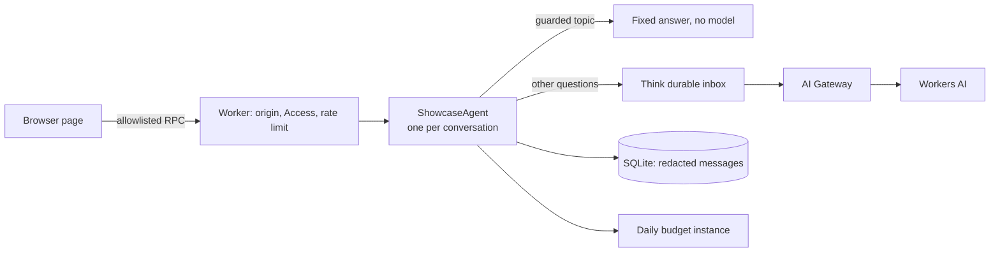

# Ask about Brett

A public profile site with an AI advocate. Visitors, especially recruiters and interviewers, read a concise profile and ask questions about the work behind it, by typing or speaking, with answers streamed back and available as audio.

It runs entirely on Cloudflare: Workers for the site, a Durable Object per visitor conversation, the Think agent framework for durable turns, and Workers AI through AI Gateway.

The repository contains only invented sample content. The real profile lives in gitignored files.

## How it works



1. Each browser creates a random 128-bit conversation ID and keeps it in `localStorage`. There is no shared conversation.
2. The Worker checks the route, origin, connection rate and access policy, removes internal headers, and adds a hashed daily visitor key.
3. The agent validates each call with zod. Guarded topics get a fixed reply with no model call.
4. Other questions enter Think's durable inbox under an idempotency key, so a retry cannot start a second paid turn.
5. Each turn has no tools, one step, at most 700 output tokens and a low temperature. Profile facts sit in the system prompt. The question and up to three recent redacted exchanges sit in a per-turn untrusted delimiter.
6. Streamed and stored text passes through a redactor. Think's raw transcript is cleared after each turn.

| Path | Responsibility |
| --- | --- |
| `src/index.ts` | Worker routing and connection policy |
| `src/agent.ts` | `ShowcaseAgent`: durable turns, storage, limits and browser methods |
| `src/access.ts` | Optional Cloudflare Access verification |
| `src/domain/content.ts` | Site schema, public-copy rules and knowledge sanitizing |
| `src/domain/guards.ts` | Deterministic topic guards and fixed answers |
| `src/domain/prompt.ts` | Turn prompts and offline answers |
| `src/domain/redaction.ts` | Normalization, secret masking and answer filtering |
| `src/domain/schemas.ts` | RPC schemas and the client frame allowlist |
| `src/llm.ts`, `src/speech.ts`, `src/models.ts` | Gateway-routed models with fallbacks |
| `scripts/build-content.mjs` | Generates the Worker's profile module and `public/site.json` |
| `client/`, `public/` | The site |

## Content setup

| File | Committed | Purpose |
| --- | --- | --- |
| `content/knowledge-base.example.md` | Yes | Invented knowledge base |
| `content/site.example.json` | Yes | Invented site content |
| `content/knowledge-base.md` | No | Real knowledge base |
| `content/site.json` | No | Real site content |
| `src/generated/knowledge.ts` | No | Generated model context and contact details |
| `public/site.json` | No | Generated public site content |

`npm run content` uses the real files when both exist and the examples otherwise. It runs automatically before the client build, tests and type checks. Set `CONTENT_MODE=example` to force the examples.

The generator removes the knowledge base's title block and its numbered instruction section, withholds money figures and phone numbers, and stops if any removed line survives. Those rules are enforced in code instead of being passed to the model.

`site.json` is validated by `siteSchema`. The build fails on a title outside the held-title list, a money figure, a phone number, or a target role that is not worded as something being sought.

## Local use

Requires Node.js 22.18 or later.

```powershell
npm install
npm run check
npm run dev
```

Open <http://127.0.0.1:8787>.

`npm run dev` is fully offline. Answers are labeled previews matched from the profile text, voice input returns a labeled sample transcript, and Listen plays a test tone. No Cloudflare account is needed and no model is called.

`npm run dev:ai` uses real models from a local Worker. It requires `npx wrangler login`, uses your account and can incur charges.

`npm run check` runs TypeScript and all tests, and fails below 80% statements, branches, functions or lines across `src` and `client`. Server tests run in the Workers runtime, and browser code runs in a simulated DOM.

## Models

Model IDs live in `src/models.ts`. Every call goes through the `codex-guard` AI Gateway, an existing gateway ID kept so its logs and limits carry over. Requests carry `app: ask-brett` metadata.

| Purpose | Primary | Fallback |
| --- | --- | --- |
| Language | `@cf/deepseek-ai/deepseek-v4.1-flash-1017` | `@cf/thinkingmachines/inkling-2-small` |
| Speech to text | `@cf/deepgram/nova-3` | `@cf/openai/whisper-large-v3-turbo` |
| Text to speech | `@cf/deepgram/aura-2-en` | `@cf/deepgram/aura-1` |

Nova runs through the gateway's HTTP endpoint only when the `AI_GATEWAY_TOKEN` Worker secret is set. Otherwise speech recognition uses Whisper through the gateway.

## Deployment

Place the real content files first, and confirm the build reports `generated from private content`. Then deploy the public site:

```powershell
npm run deploy:public
```

Without `deploy:public`, real-model mode refuses connections until Cloudflare Access is configured:

```powershell
npm run deploy -- --var ACCESS_TEAM_DOMAIN:your-team --var ACCESS_AUD:your-audience-tag
```

The class and Worker names are new, so this deploys as a new Worker with a fresh `ShowcaseAgent` migration. Add a spend limit under **AI > AI Gateway > Settings > Spend limits**. `npm run gateway:plan` prints the gateway settings, and `npm run gateway:apply` applies them using `CLOUDFLARE_ACCOUNT_ID` and a short-lived, gateway-scoped `CLOUDFLARE_API_TOKEN`.

Default limits are 500 AI units a day overall, 40 per visitor network, 60 actions per conversation per hour and 300 per minute across the site. Speech costs five units. Fixed replies cost none.

Security controls and remaining risks are in [`SECURITY.md`](./SECURITY.md). [`PROMPTS.md`](./PROMPTS.md) is the historical record of how this project was built, including its earlier form.
